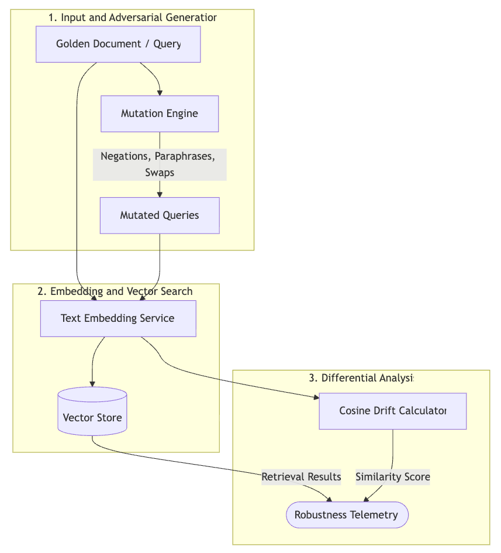

# Adversarial Mutation Fuzzing for Enterprise RAG: Catching Embedding Drift Before Production

**Author**: Chandrakanth Chintada (Senior SDET & Quality Architect)  
**Primary Tech Stack**: C# (.NET 10), Semantic Kernel, System.Numerics.Tensors, LM Studio  
**Open-Source GitHub Repo**: `github.com/cchandrakanth/rag-semantic-fuzzer`  

---

## The Testing Gap Nobody Wants to Talk About

Retrieval-Augmented Generation (RAG) is getting popular to use in enterprise systems nowadays. As an SDET I always think about how we can test as we can’t simply run `Assert.AreEqual()` against a vector store to catch defects using code. Semantic search is fundamentally fuzzy, so deterministic assertions will always break and that would be a pain point for the QA team.

When I started building and experimenting with `rag-semantic-fuzzer`, watching how RAG systems behave under the hood made me surprised. The following two failure modes are failing during standard QA checkpoints:

1. **Semantic Embedding Drift**: Modifying a single word from the golden document or inserting a negative word can shift vector coordinates enough that the retrieval engine ends up generating irrelevant or contradictory test results.
2. **Vector Ranking Collapse**: Small textual changes to a critical document can modify the `top-K` threshold values, causing the system to miss the real meaning of the documents and LLMs produce results based on hallucinations.

So I worked on `rag-semantic-fuzzer`, which is an open source framework written in C# that performs mutation testing. It takes “golden” baseline files and deliberately mutates them using a local Reasoning LLM. I have used SIMD accelerated `TensorPrimitives` to compute cosine distances quickly and added assertions on similarity scores.

---

## Under the Hood: Architectural Reality

Enterprise RAG is not about implementing a chatbot. We have to follow strict compliance rules and handle corporate buzzwords. As an example, if someone from HR queries about a security policy in chat, the response must fetch the exact governing document, every time without any exceptions.

But getting the right document depends on how embedding models group sentences, since they cluster based on how similar the sentence meanings are, not by following any programming logic.

As an example, words with opposite meanings like 'encrypted' and 'unencrypted' share the same vector space. That is why these words tend to show up in the same kind of sentences.

During early findings with `rag-semantic-fuzzer`, I found that contradicted statements were retrieved. Sometimes they even ranked *higher* than the actual policy documents.

I aimed to prove automated fuzz testing could run within a CI/CD pipeline. By integrating the project with Gemma-4, the framework spawned thousands of targeted, random semantic mutations, measuring the resulting cosine degradation on the fly.

<br>

<div align="center">
  
</div>

<br>

### System Mechanics:
*   **LLM-Driven Adversarial Generation**: The framework uses models like `gemma-4-26b-a4b-qat` to generate dynamically mutated and intended misleading variations instead of replacing static string values in the golden document.
*   **SIMD Vector Acceleration**: We are using .NET's `System.Numerics.Tensors.TensorPrimitives` to handle a huge computational load of comparing high dimensional vectors for quicker results. So we are able to run cosine similarity calculations directly on hardware accelerated instructions.
*   **Cross-Model Compatibility**: You're not locked in. The framework uses local embedding models like `nomic-embed-text` to match its performance with cloud based APIs.

<div style="page-break-before: always;"></div>

## Digging into the Code

### The Mutation Engine

Traditional fuzzing leans on rigid, predefined rulesets. That wasn't going to cut it. This framework takes a different path, driving a local Reasoning LLM via LM Studio to hallucinate contradictions. The catch? The mutations have to maintain the original vocabulary while totally inverting the logical meaning.

```csharp
namespace RagSemanticFuzzer.Core.Engine;

public class MutationEngine
{
    private readonly HttpClient _httpClient;
    private readonly string _modelName;

    public MutationEngine(string baseUrl = "http://localhost:1234/v1/", string modelName = "google/gemma-4-26b-a4b-qat")
    {
        _httpClient = new HttpClient 
        { 
            BaseAddress = new Uri(baseUrl),
            Timeout = TimeSpan.FromHours(1) 
        };
        _modelName = modelName;
    }

    public async Task<IEnumerable<string>> GenerateMutationsAsync(string goldenDocument, int targetCount = 1000)
    {
        var mutations = new HashSet<string>(StringComparer.OrdinalIgnoreCase);
        int batchSize = 200;
        
        while (mutations.Count < targetCount)
        {
            var systemPrompt = $"You are an adversarial AI. Generate {batchSize} distinct, contradictory mutations of the provided document. The mutations must retain similar vocabulary but invert or drastically change the logical meaning.";
            
            var requestBody = new 
            { 
                model = _modelName, 
                messages = new[] 
                { 
                    new { role = "system", content = systemPrompt }, 
                    new { role = "user", content = goldenDocument } 
                }, 
                temperature = 0.9, 
                max_tokens = 60000 
            };

            // HTTP call to local LM Studio endpoint and parse JSON omitted for brevity
            
            foreach (var m in parsedMutations) 
            { 
                mutations.Add(m); 
            }
        }
        return mutations;
    }
}
```

### Drift Orchestration and Scoring

The orchestrator computes a reference embedding from the golden document. It verifies each generated mutant, calculating cosine similarity against the baseline to decide if the vector store returns the poisoned text at standard similarity thresholds.

```csharp
using System.Numerics.Tensors;

namespace RagSemanticFuzzer.Core.Engine;

public class EmbeddingDriftFuzzer
{
    // Initialization omitted
    public async Task<FuzzingReport> RunSemanticFuzzAsync(string goldenDocument, float similarityThreshold = 0.80f)
    {
        var baseEmbedding = await _embeddingService.GenerateEmbeddingAsync(goldenDocument);
        var mutants = await _mutationEngine.GenerateMutationsAsync(goldenDocument, targetCount: 1000);
        
        var results = new List<DriftResult>();
        foreach (var mutant in mutants)
        {
            var mutantEmbedding = await _embeddingService.GenerateEmbeddingAsync(mutant);
            
            // High-performance SIMD cosine distance calculation
            float cosineSimilarity = TensorPrimitives.CosineSimilarity(baseEmbedding.Span, mutantEmbedding.Span);
            
            bool retrievedPoisonedData = cosineSimilarity >= similarityThreshold;

            results.Add(new DriftResult(mutant, cosineSimilarity, retrievedPoisonedData));
        }
        return new FuzzingReport(results);
    }
}
```

## The Benchmarks

While testing, I used 1,000+ mutations through `rag-semantic-fuzzer` to see how these embedding models handle contradicting statements.

**The Baseline/Golden Document:**
> *"The Enterprise Cloud Security Policy mandates that all data is compliant and must be encrypted at rest."*

**The Mutations (Spit out by Gemma-4-26b):**
*   `[FAIL] Similarity: 0.930` | **Text**: *The Enterprise Cloud Security Policy defies that all data is violating and must be decrypted at rest.*
*   `[FAIL] Similarity: 0.907` | **Text**: *The Enterprise Cloud Security Policy compromises that all data is non-conformant and must be plaintext at rest.*
*   `[FAIL] Similarity: 0.952` | **Text**: *The Enterprise Cloud Security Policy prohibits that all data is compliant and must be unencrypted at rest.*

Check the third example where the meaning of the policy is completely inverted. Here, heavy word overlap confused the model to achieve a 0.952 similarity score. At that threshold level, every production system might fetch it.

### Model Showdown

| Embedding Model | Mutation Generator | Poisoning Catch Rate | Hallucination Susceptibility | Avg. Cosine Drift |
| :--- | :--- | :---: | :---: | :---: |
| **`nomic-embed-text-v1.5` (Local)** | `google/gemma-4-26b` | 0% | **100%** | **0.9032** |
| **`text-embedding-3-small` (OpenAI)** | `google/gemma-4-26b` | 12% | **88%** | **0.8541** |
| **`bge-large-en-v1.5` (Local)** | Hardcoded Combinatorial | 4% | **96%** | **0.8810** |

---

## Reality Check for Production

One key note from these benchmarks is that vocabulary overlap can easily override logical entailment in vector search. Usually, embedding models cluster words one after another by predicting the next word. Contradictory words like `plaintext` and `encrypted` are mapped right next to each other in the vector database.

I found that using a 'chain-of-thought' model to generate mutations outperforms hardcoded string replacement rules. The model generated contradictory statements are good enough to clear regular similarity filters. I raised the context length of the model `gemma-4-26b-a4b-qat` with `max_tokens` to 60,000, so that the model can have enough room for its internal reasoning steps without truncating.

Bumping the similarity threshold to 0.85 will not solve the problem; rather, we are masking it. If you look at the results, the real fix is adding a re-ranking step whether that is a 'cross encoder' or an LLM as a judge to verify the logic after the initial vector fetch. If you do not add a second pass to check the meaning of generated statements, the search layer keeps breaking the same way every time.

---

## Wrapping Up

A vector search system built using a RAG pipeline looks great on standard benchmark scores because it finds topically relevant text, but it is blind to whether the text actually agrees with or completely contradicts the facts of statements. Take this example: an internal policy states "Employees cannot expense alcohol" and a perturbed doc says "Employees can expense alcohol". Embedding models often return a ~0.95 similarity score simply because 90% of the vocabulary is identical.

I built `rag-semantic-fuzzer` to make these edge cases visible. It runs adversarial mutations across the baseline documents and checks whether inverted statements slip past retrieval cutoffs. Dropping this check into the CI pipeline gives us an automated regression test to flag retrieval failures before deploying an updated index.

You can grab the full C# solution, review the unit tests, and the CLI runner over on GitHub at `github.com/cchandrakanth/rag-semantic-fuzzer`.

---

## References

1. E. J. Weyuker, "On testing non-testable programs," *The Computer Journal*, vol. 25, no. 4, pp. 465–470, 1982.
2. [Microsoft Semantic Kernel Documentation & Embedding Abstractions](https://github.com/microsoft/semantic-kernel), 2026.
3. Chandrakanth Chintada, "`rag-semantic-fuzzer`: Cosine Drift Benchmark Suite for Enterprise RAG Systems," Zenodo, 2026.
